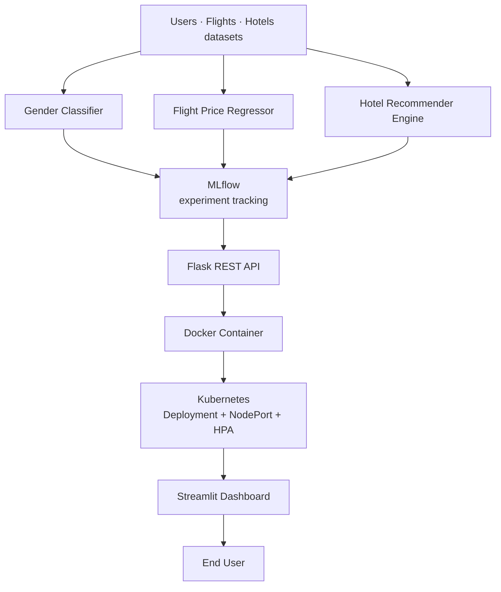

Project Name:-Voyage Analytics: Integrating MLOps in Travel Productionization of ML System

End-to-end Machine Learning + MLOps system for the travel industry — predicting flight prices, classifying users, and recommending hotels, deployed as a production-grade application.

Team: Ashwini Maske · Manish Bhoye · Vedant Deshmukh

📌 Problem Statement

Travel companies sit on huge amounts of underused data — who's flying where, how much they pay, and what hotels they book. This project turns three raw datasets (users, flights, hotels) into a working, production-deployed ML system, while demonstrating real-world MLOps practices (tracking, serving, containerization, orchestration).

💡 Business Insight
Flight pricing is highly predictable from route, agency, and date features — a well-tuned model (R² = 0.99999) can power dynamic pricing displays, fare-alert tools, or budget planning features with near-zero error.
Gender classification from name/company/age alone caps out around 56% accuracy — a useful finding in itself: it shows this data isn't a reliable proxy for demographics, discouraging over-reliance on it for personalization without stronger signals.
Collaborative-filtering hotel recommendations cut search time for travelers by surfacing personalized options from similar users' booking history — a direct lever for conversion and customer satisfaction.
Packaging the whole pipeline with Docker + Kubernetes + MLflow means the business isn't just getting a model — it's getting a system that can be updated, scaled, and monitored like any production software, reducing the cost of maintaining ML in production.
🏗️ Architecture
Users • Flights • Hotels
        │
        ▼
Gender Classifier │ Flight Price Regressor │ Recommender Engine
        │
        ▼
  MLflow → Flask REST API → Docker → Kubernetes + HPA
        │
        ▼
   Streamlit Dashboard → End User
🛠️ Tech Stack

Python scikit-learn Flask Docker Kubernetes MLflow Streamlit

🧩 Modules
#	Module	Approach	Result
1	Flight Price Prediction	Linear Reg. · Decision Tree · Random Forest · Gradient Boosting	Random Forest — R² 0.99999, RMSE 1.14
2	REST API	Flask /predict, /health endpoints	Real-time predictions, e.g. ₹361.96
3	Containerization	Docker image of app + model	Portable, consistent runtime
4	Orchestration	Kubernetes Deployment + NodePort Service	Self-healing, exposed at localhost:5000
5	Autoscaling	HPA on CPU utilization	Scales 1 → 3 replicas at 50% CPU target
6	Experiment Tracking	MLflow (params, metrics, artifacts)	Full experiment comparison & reproducibility
7	Gender Classification	TF-IDF + One-Hot + Logistic Regression	56.34% accuracy, F1 55% (macro)
8	Hotel Recommendation	Collaborative filtering, cosine similarity	Top-5 personalized recommendations/user
9	Dashboard	Streamlit	Interactive UI for all predictions/insights
📊 Model Comparison (Flight Price)
Model	MAE	RMSE	R² Score
Random Forest ✅	0.0925	1.1411	0.99999
Decision Tree	0.0522	2.2671	0.99996
Gradient Boosting	38.1273	50.2538	0.98083
Linear Regression	213.6480	256.6627	0.50007
🚀 Quick Start
bash
# Install
pip install -r requirements.txt

# Run API
python app.py

# Build & run with Docker
docker build -t voyage-analytics .
docker run -p 5000:5000 voyage-analytics

# Deploy to Kubernetes
kubectl apply -f k8s/

# Track experiments
mlflow ui --port 5001# ✈️ Voyage Analytics: MLOps-Driven Travel Prediction System

**An end-to-end Machine Learning + MLOps system for the travel industry. It predicts flight prices, classifies users, and recommends hotels, and is deployed as a production-style application.**


**Team:** Ashwini Maske · Manish Bhoye · Vedant Deshmukh

---

## 📑 Table of Contents

- [Problem Statement](#-problem-statement)
- [Key Results](#-key-results)
- [Business Insights](#-business-insights)
- [Architecture](#-architecture)
- [Tech Stack](#-tech-stack)
- [Modules](#-modules)
- [Model Comparison](#-model-comparison-flight-price)
- [Quick Start](#-quick-start)
- [Project Structure](#-project-structure)
- [Future Scope](#-future-scope)
- [Authors](#-authors)

---

## 📌 Problem Statement

Travel companies hold large amounts of underused data: who is flying where, how much they pay, and which hotels they book.

This project turns three raw datasets (**users, flights, hotels**) into a working, production-deployed ML system. It also demonstrates real-world MLOps practices: **experiment tracking, model serving, containerization, orchestration, and autoscaling**.

---

## 🏆 Key Results

| Task | Approach | Result |
|---|---|---|
| Flight price prediction | Random Forest Regressor | **R² = 0.99999**, RMSE = 1.14 |
| Gender classification | TF-IDF + One-Hot + Logistic Regression | 56.34% accuracy, 55% macro F1 |
| Hotel recommendation | Collaborative filtering + cosine similarity | Top-5 personalized hotels per user |
| Deployment | Docker + Kubernetes + HPA | Autoscales from 1 to 3 replicas at 50% CPU |

---

## 💡 Business Insights

- **Flight prices are highly predictable.** Route, agency, and date features are enough for a well-tuned model to reach R² = 0.99999. This can power dynamic pricing displays, fare-alert tools, or budget-planning features.
- **Gender cannot be reliably inferred from name, company, and age alone.** Accuracy caps out around 56%. This is a useful finding in itself: this data is not a reliable proxy for demographics, so personalization should not rely on it without stronger signals.
- **Collaborative-filtering recommendations reduce search effort.** Surfacing hotels that similar users booked gives travelers personalized options, which supports conversion and customer satisfaction.
- **The business gets a system, not just a model.** Docker, Kubernetes, and MLflow mean the pipeline can be updated, scaled, and monitored like production software, which lowers the cost of maintaining ML in production.

---

## 🏗️ Architecture



---

## 🛠️ Tech Stack

| Category | Technologies |
|---|---|
| Language | Python |
| Machine Learning | scikit-learn, Pandas, NumPy |
| Experiment Tracking | MLflow |
| API | Flask (REST) |
| Containerization | Docker |
| Orchestration | Kubernetes (Deployment, NodePort Service, HPA) |
| Dashboard | Streamlit |

---

## 🧩 Modules

| # | Module | Approach | Result |
|---|---|---|---|
| 1 | Flight Price Prediction | Linear Regression · Decision Tree · Random Forest · Gradient Boosting | Random Forest: R² 0.99999, RMSE 1.14 |
| 2 | REST API | Flask `/predict` and `/health` endpoints | Real-time predictions, e.g. ₹361.96 |
| 3 | Containerization | Docker image of app + model | Portable, consistent runtime |
| 4 | Orchestration | Kubernetes Deployment + NodePort Service | Self-healing, exposed at `localhost:5000` |
| 5 | Autoscaling | Horizontal Pod Autoscaler on CPU utilization | Scales 1 → 3 replicas at 50% CPU target |
| 6 | Experiment Tracking | MLflow (params, metrics, artifacts) | Full experiment comparison and reproducibility |
| 7 | Gender Classification | TF-IDF + One-Hot + Logistic Regression | 56.34% accuracy, 55% macro F1 |
| 8 | Hotel Recommendation | Collaborative filtering, cosine similarity | Top-5 personalized recommendations per user |
| 9 | Dashboard | Streamlit | Interactive UI for all predictions and insights |

---

## 📊 Model Comparison (Flight Price)

| Model | MAE | RMSE | R² Score |
|---|---|---|---|
| **Random Forest** ✅ | 0.0925 | 1.1411 | **0.99999** |
| Decision Tree | 0.0522 | 2.2671 | 0.99996 |
| Gradient Boosting | 38.1273 | 50.2538 | 0.98083 |
| Linear Regression | 213.6480 | 256.6627 | 0.50007 |

Random Forest was selected as the final model because it has the lowest RMSE and the highest R² score.

---

## 🚀 Quick Start

### Prerequisites

- Python 3.x and `pip`
- Docker (for containerization)
- `kubectl` and a local Kubernetes cluster such as Docker Desktop, Minikube, or kind (for orchestration)

### 1. Clone the repository

```bash
git clone https://github.com/MANISH-DATTU-BHOYE/Voyage-Analytics-MLOps-Driven-Travel-Prediction-System.git
cd Voyage-Analytics-MLOps-Driven-Travel-Prediction-System
```

### 2. Install dependencies

```bash
python -m venv .venv
source .venv/bin/activate        # Windows: .venv\Scripts\activate
pip install -r requirements.txt
```

### 3. Run the Flask API

```bash
python app.py
```

Check that it is running:

```bash
curl http://localhost:5000/health
```

The `/predict` endpoint accepts a JSON body with flight details. See `app.py` for the expected fields.

### 4. Build and run with Docker

```bash
docker build -t voyage-analytics .
docker run -p 5000:5000 voyage-analytics
```

### 5. Deploy to Kubernetes

```bash
kubectl apply -f k8s/
kubectl get pods
kubectl get hpa
```

The service is exposed through a NodePort at `localhost:5000`. The HPA scales between 1 and 3 replicas at a 50% CPU target.

### 6. Track experiments with MLflow

```bash
mlflow ui --port 5001
```

Open http://localhost:5001 to compare runs, parameters, metrics, and artifacts.

### 7. Launch the Streamlit dashboard

```bash
streamlit run streamlit_app.py
```

---

## 📁 Project Structure

```text
voyage-analytics/
├── data/              # users.csv, flights.csv, hotels.csv
├── models/            # flight_price_model.pkl, gender_classifier.pkl
├── src/               # preprocessing and training scripts
├── k8s/               # deployment.yaml, service.yaml, hpa.yaml
├── app.py             # Flask REST API
├── streamlit_app.py   # Streamlit dashboard
├── Dockerfile
└── requirements.txt
```

---

## 🔭 Future Scope

- Real-time pricing APIs
- Richer user features for stronger demographic and preference signals
- Deep-learning recommenders
- Automated model retraining
- Cloud deployment
- Centralized monitoring
- CI/CD automation

---

## 👥 Authors

- **Ashwini Maske**
- **Manish Bhoye** ([GitHub](https://github.com/MANISH-DATTU-BHOYE))
- **Vedant Deshmukh**

> Capstone project demonstrating a complete ML → MLOps production workflow.

# Launch dashboard
streamlit run streamlit_app.py
📁 Structure
voyage-analytics/
├── data/            # users.csv, flights.csv, hotels.csv
├── models/          # flight_price_model.pkl, gender_classifier.pkl
├── src/             # preprocessing & training scripts
├── app.py           # Flask REST API
├── streamlit_app.py # Dashboard
├── Dockerfile
├── k8s/             # deployment.yaml, service.yaml, hpa.yaml
└── requirements.txt
🔭 Future Scope

Real-time pricing APIs · richer user features · deep-learning recommenders · automated retraining · cloud deployment · centralized monitoring · CI/CD automation

Capstone project demonstrating a complete ML → MLOps production workflow.
